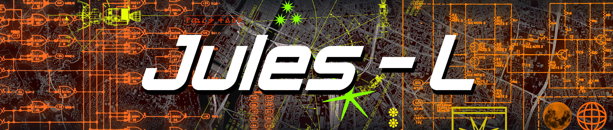

 

Bienvenue sur ma page github !

Mes projets phares sont :

* [Cardea](https://github.com/L-Jules/Cardea) : un projet de scanneur NFC-V pour une bibliothèque, l'application permet de faire un inventaire en cumulant les scans !
* [Fractal](https://github.com/L-Jules/Fractal) : passionné de math, j'ai fait ce projet pour comprendre les fractales, il permet de génerer les ensembles de Julia, l'ensemble de mandelbrot et le burning ship

<!---->
